# profile-garden

An animated allotment for your GitHub profile: every day of contributions becomes a plant, redrawn daily by a GitHub Action.

<picture>
  <source media="(prefers-color-scheme: dark)" srcset="docs/preview/garden-night.svg">
  <source media="(prefers-color-scheme: light)" srcset="docs/preview/garden-day.svg">
  
</picture>

Light theme gets the day garden, dark theme the night garden. Zero dependencies, plain SVG + CSS, no JavaScript in the images.

## What it shows

- **Beds are months.** Twelve raised beds cover the last 12 calendar months, through yesterday. Days later in the current month stay bare until they come.
- **One plant per day**, sized by that day's contributions:

  | Contributions | 0 | 1 | 2–3 | 4–6 | 7+ |
  |---|---|---|---|---|---|
  | Plant | bare soil | sprout | seedling | growing | harvest |

- **Seasonal crops.** Each month grows its own crop: tomatoes and corn in summer, pumpkins and carrots in autumn, brassicas and garlic in winter, peas, lettuce, beans and strawberries in spring. Set `hemisphere` so summer lands in Dec–Feb (`south`) or Jun–Aug (`north`).
- **Prize crop.** Your best day wears a rosette with its count.
- **The gardener** stands at yesterday's plant: watering can by day, lantern at night.
- **The sign** shows your plot name, contributions in the window and your longest streak.
- **At night:** moon, stars, fireflies, festoon lights, a lit shed, an owl and a fox, and a gold star with a number on each day you passed another 100 contributions. The hens go to bed and the cat on the shed roof wakes up to watch the moon.

Optional extras for your README, built from the same data: a garden-gate banner with your name, a growth legend, "currently growing" seedling trays (this week, this month, active days of the last 30), seed packets for your pinned repos, a tech stack as plant markers, and a fence footer.

<p align="center">
  
  
  
  
</p>

## Set up in 5 minutes

You need a [profile repo](https://docs.github.com/en/account-and-profile/setting-up-and-managing-your-github-profile/customizing-your-profile/managing-your-profile-readme): a public repo named exactly like your username (`you/you`) with a `README.md`.

1. **Copy this repo.** Click **Use this template** (or fork it). Public is simplest: Actions minutes are free for public repos.
2. **Edit `garden.config.json`.** Set `login`, `timezone` and `hemisphere`, then replace the `readme` section with your own text (or set `"enabled": false`). The committed file is the author's own; see the [reference](#configuration) below.
3. **Create a token.** GitHub → Settings → Developer settings → Personal access tokens → **Fine-grained tokens** → Generate new token:
   - Repository access: **Only select repositories** → your profile repo only
   - Permissions → Repository → **Contents: Read and write**

   In your copy of this repo, go to Settings → Secrets and variables → Actions and add it as **`PROFILE_TOKEN`**.
4. **Add the garden to your profile README** (`you/you/README.md`):

   ```html
   <picture>
     <source media="(prefers-color-scheme: dark)" srcset="profile-garden/garden-night.svg">
     <source media="(prefers-color-scheme: light)" srcset="profile-garden/garden-day.svg">
     
   </picture>
   ```

   For the README extras, use the same pattern with `readme/<name>-day.svg` / `readme/<name>-night.svg`, where `<name>` is `banner`, `legend`, `growing`, `stack` or `footer`. For seed packets, add these two lines where they should go; the workflow fills in between them:

   ```html
   <!-- seed-packets:start -->
   <!-- seed-packets:end -->
   ```
5. **Run it once.** Actions tab → enable workflows if asked (forks start with them off) → **garden** → **Run workflow**. After that it runs daily.

## Configuration

`garden.config.json` is checked every run; a mistake fails the run early with a message naming the field. Only `login` is required.

| Field | Default | Meaning |
|---|---|---|
| `login` | (required) | Your GitHub username. |
| `profileRepo` | `<login>/<login>` | Repo the images are committed to. |
| `signName` | `<LOGIN>'S PLOT` | Top line of the garden sign (max 18 characters). |
| `timezone` | `UTC` | IANA time zone, e.g. `Europe/London`. Decides what "today" and "yesterday" are. |
| `hemisphere` | `north` | `north` or `south`. Picks which months grow summer crops. |
| `outputDir` | `profile-garden` | Folder in the profile repo for `garden-day.svg` and `garden-night.svg`. |
| `readme.enabled` | `true` | `false` skips the README extras entirely. |
| `readme.imagesDir` | `readme` | Folder in the profile repo for the README extras. |
| `readme.banner.name` | `<login>` | Big board on the gate banner (max 20). |
| `readme.banner.title` | none | Smaller board below it (max 42). Omit to hide. |
| `readme.banner.tagline` | none | Line above the arch (max 54). |
| `readme.stack` | `[]` | Names for the plant-marker stack image. Empty: no stack image. Names over 12 characters wrap at spaces. |
| `readme.footer.left` / `.right` | none | Signpost labels on the fence footer (max 20 each). |
| `readme.packets.exclude` | `[]` | Pinned repos to skip. The profile repo and private repos are always skipped. |
| `readme.packets.overrides` | `{}` | Per-repo packet content: `{ "<repo>": { "line", "tags", "title", "url", "art" } }`. `art` is one of `filmstrip`, `radar`, `python`, `typescript`, `javascript`, `flower`; otherwise it is picked from the repo's main language. |

Seed packets come from your pinned repos (up to 6, in pinned order). A repo needs a description or an override to get one.

Minimal config:

```json
{
  "login": "octocat",
  "timezone": "America/New_York",
  "hemisphere": "north",
  "readme": { "enabled": false }
}
```

## How it works

1. **Fetch.** The workflow queries GitHub's GraphQL API for your contribution calendar (and pinned repos, for packets) with `PROFILE_TOKEN`.
2. **Render.** Pure functions turn the calendar into SVG. Decoration uses a seeded random generator, so the same data always gives the same bytes and only real changes get committed.
3. **Animate with CSS only.** Plants grow in, things sway and fireflies blink with plain CSS keyframes inside the SVG: no scripts and no CSS variables, which GitHub's image proxy (camo) strips.
4. **Render, then write.** Both images are rendered in memory before anything is written, and the profile repo is only checked out after every render succeeded. A failed API call or render leaves yesterday's garden in place.
5. **Daily cron.** `0 18 * * *` (18:00 UTC). Change the `cron` line in `.github/workflows/garden.yml` to run shortly after midnight in your time zone.
6. **Seed packets on phones.** A README cannot reflow, so each packet is listed twice: three across for wide screens and two larger per line for screens up to 600px wide. The copy meant for the other size swaps itself for `spacer.svg`, an image about one pixel tall. The trade-off is a little blank space where the hidden copy sits.

## Local development

Node 20+ (CI uses 24), no install step.

```sh
npm test                                   # unit tests
node src/main.mjs --fixture tests/fixtures/calendar-2026-10-17.json --out out
node src/readme/build.mjs --fixture tests/fixtures/calendar-2026-10-17.json --pinned tests/fixtures/pinned.json --out out/readme
npm run preview                            # regenerate docs/preview from the fixtures
node src/config.mjs                        # print the resolved config (or --get readme.imagesDir)
```

Without `--fixture`, set `GH_TOKEN` to fetch live data. Every command takes `--config <file>` to use a config other than `./garden.config.json`. The fixtures are synthetic; `npm run make-fixture` regenerates the calendar.

## Notes

- **Private contributions** only show if you turn on Settings → Public profile → Contributions & activity → **Include private contributions on my profile**. The garden counts what your profile counts.
- **Token expiry.** Fine-grained tokens expire on the date you pick, and GitHub emails you beforehand. When it lapses the workflow fails with HTTP 401: create a new token and update the `PROFILE_TOKEN` secret.
- GitHub buckets contributions by UTC or by the commit's own time zone, so the newest day can be off by a few hours. The next daily run corrects it.

## License

[MIT](LICENSE)
